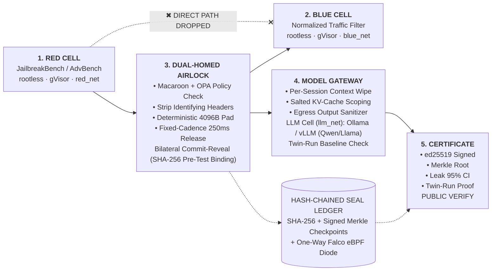

# TriSeal (PS-4) — Sealed Multi-Party AI Safety Evaluation & Verification Engine

> **"Three parties. Three seals. One finding you can prove."**

**Team Pinnacle** · Hack In Hills — PS-4 Submission · v2.4.0
Rootless gVisor Cells · Dual-Homed Fixed-Cadence Airlock · SHA-256 Merkle Seal Ledger · Leak Hunter 95% CI

## Table of Contents

1. [Executive Summary & Problem Statement](#1-executive-summary--problem-statement)
2. [Architecture & Zero-Trust Data Flow](#2-architecture--zero-trust-data-flow)
3. [PS-4 Theme Alignment (7 Verticals & 6 Objectives)](#3-complete-ps-4-theme-alignment-all-7-verticals--6-objectives)
4. [MVP Scope & Tiered Architecture](#4-mvp-scope--tiered-architecture)
5. [Quick Start](#5-quick-start-deploy-to-vercel-or-run-locally-with-docker-compose)
6. [Honest Threat Model & Residual Risk Matrix](#6-honest-threat-model--residual-risk-matrix)
7. [Team Pinnacle — Engineering Ownership](#7-team-pinnacle--engineering-ownership)
8. [Merkle Proof & CI/CD Release Gate Architecture](#8-merkle-proof--cicd-release-gate-architecture-tab-06)

## 1. Executive Summary & Problem Statement

In contemporary AI safety evaluations, the **Red Team** (attackers), **Blue Team** (defenders), and the **Client's LLM** share a single Docker-based cloud sandbox. However, the validity of every safety finding depends entirely on strict isolation between them—and today that evidence is merely *"trust us."*

1. **Red payloads can be seen by Blue:** When containers share networks or staging mounts, the defense adapts dynamically to attacks it should not have seen, making guardrail efficacy look artificially stronger than it really is (e.g., inflating block rates from `66%` to `96%`).
2. **Blue logic can be inferred by Red:** Response timing differentials (`14ms` filter block vs. `410ms` LLM generation), packet lengths, shared files, or DNS/ICMP side channels let attackers reverse-engineer proprietary defense logic.
3. **The LLM gets contaminated:** Shared multi-tenant KV-caches ([NDSS 2025](https://www.ndss-symposium.org)), leftover session context, and noisy-neighbor CPU/IO contention mean evaluation scores reflect environmental artifacts rather than the model itself.
4. **Findings cannot be proven:** Standard container logs can be edited after the fact, leaving no tamper-evident audit trail to reconstruct or defend a safety claim under [EU AI Act](https://artificialintelligenceact.eu/), [NIST AI RMF](https://www.nist.gov/itl/ai-risk-management-framework), or ISO/IEC 42001 scrutiny.

**TriSeal** solves this in pure open-source software (`docker compose up` on any Linux host or laptop, with zero proprietary SGX/SEV hardware required) by running Red, Blue, and the Model simultaneously in **sealed rootless gVisor cells**, routing all traffic through a **normalizing, 4096-byte padded, 250ms fixed-cadence Airlock**, and issuing a cryptographically signed **TriSeal Certificate** verifiable by any third party.

## 2. Architecture & Zero-Trust Data Flow



### The 8-Stage TriSeal Protocol

| Stage | Protocol Step | Technical Mechanism | FastAPI Endpoint / Tooling |
| :--- | :--- | :--- | :--- |
| **01** | **Contract** | An explicit `isolation-contract.yaml` declares allowed network flows, syscalls, and cgroup v2 caps. | `GET /api/contract/check` |
| **02** | **Seal** | Each party runs in a rootless [gVisor (`runsc`)](https://gvisor.dev) container; live state is verified against the contract. | Docker + `runsc` + `seccomp` |
| **03** | **Bind** | Red commits a SHA-256 hash of its salted payload set; Blue commits a SHA-256 hash of its defense config. | `POST /api/commit` |
| **04** | **Relay** | Traffic crosses the Dual-Homed Airlock: Macaroon token check, [OPA](https://www.openpolicyagent.org) policy, strip headers, pad to `4096B`, pace at `250ms`. | `POST /api/relay` → `/api/defend` |
| **05** | **Record** | Every event is appended to a SHA-256 hash-chained ledger with `ed25519`-signed Merkle checkpoints ([RFC 6962](https://datatracker.ietf.org/doc/html/rfc6962)). | `POST /api/ledger/append` |
| **06** | **Hunt** | **Leak Hunter** probes timing, volume, cache, and DNS/ICMP channels, reporting accuracy with a 95% bootstrap CI. | `POST /api/leakhunt` (SciPy) |
| **07** | **Twin-Run** | Attacks replay in a solo clean-room baseline container; KL-divergence flags any cross-session contamination. | `POST /api/twinrun` |
| **08** | **Certify** | Reveals are checked against pre-test commitments and bundled into a portable, `ed25519`-signed **TriSeal Certificate**. | `GET /api/certificate`, `POST /api/verify` |

## 3. Complete PS-4 Theme Alignment (All 7 Verticals & 6 Objectives)

| PS-4 Security Vertical | TriSeal Engineering Implementation | Verification Method |
| :--- | :--- | :--- |
| **1. Container & Sandbox Isolation** | Rootless containers, [gVisor (`runsc`)](https://gvisor.dev) (fallback: hardened `runc`), `seccomp` allowlists, `cap_drop: [ALL]`, `read_only` rootfs, cgroup v2 | Runtime Conformance Checker (`GET /api/contract/check`) |
| **2. Network Segmentation** | One internal bridge network per cell (`red_net`, `blue_net`, `llm_net`), default-deny `nftables` / [Cilium](https://cilium.io); only Airlock is dual-homed | Deterministic Red→Blue socket breach test (`DROP` + log) |
| **3. Access Control & Secrets** | Short-lived Macaroon capability tokens scoped per cell and action, [Open Policy Agent (OPA)](https://www.openpolicyagent.org), HashiCorp Vault / SOPS | Airlock policy gate (`policy/airlock.rego`) |
| **4. Audit Trails & Provenance** | Append-only SHA-256 hash chain, `ed25519`-signed Merkle tree checkpoints, bilateral commit-reveal, offline public verifier | `python3 cli/triseal_verify.py --cert cert.json` |
| **5. Resource Governance & Fairness** | cgroup v2 CPU/memory/IO limits, CPU pinning, `250ms` fixed-cadence Airlock release, host noise-floor calibration (`0.42ms σ`) | Validity Score & Cadence jitter monitor |
| **6. LLM-Specific Threats** | Model Gateway per-session context wipe, tenant-scoped KV-cache salting/flush ([vLLM](https://docs.vllm.ai) / Ollama), output sanitization, Twin-Run | Twin-Run Differential Check (`KL-Div < 0.020`) |
| **7. Observability & Anomaly Detection** | [Falco](https://falco.org) eBPF syscall/network anomaly detection, one-way data diode to dashboard, armed **Canary Honeytokens** in every vault | Canary tripwire & one-way diode stream |

## 4. MVP Scope & Tiered Architecture

- **Tier 1 — Working Core MVP (Implemented & Interactive in Tabs 01 & 02):**
  1. Multi-network `docker-compose.yml` isolating `red_cell`, `blue_cell`, `llm_cell`, `airlock`, and `seal_ledger`.
  2. Deterministic Red-to-Blue direct connection attempt that fails at the network layer and is logged to the ledger.
  3. Airlock relay with Macaroon token check, OPA policy, `4096B` padding, `250ms` fixed-cadence release, and bilateral commit-reveal using [JailbreakBench](https://jailbreakbench.github.io) and [AdvBench](https://github.com/llm-attacks/llm-attacks) subsets.
  4. Local LLM cell (`Qwen-2.5-3B` / `Llama-3.2-3B` via Ollama/vLLM) behind a Model Gateway enforcing per-session context wipe.
  5. SHA-256 hash-chained Seal Ledger and `triseal_verify.py` CLI that detects single-byte historical tampering.
  6. Portable **TriSeal Certificate** generation and public signature/Merkle verification.
- **Tier 2 — Differentiators (Implemented & Interactive in Tabs 03 & 04):**
  7. Declarative `isolation-contract.yaml` and live Runtime Conformance Checker with container drift injection testing.
  8. **Isolation ON ("Sealed Mode") vs. Isolation OFF ("Naked Mode")** experimental benchmark comparison.
  9. **Leak Hunter** empirical distinguishability suite reporting `50.6% accuracy vs 50.0% chance (95% CI: 47.5%–53.7%, N=1000)`.
  10. **Twin-Run Differential Check** replaying identical prompts in a clean solo baseline to detect contamination.
  11. Armed **Canary Honeytokens** in every vault and live 5×5 **Isolation Matrix** dashboard.
- **Tier 3 — Enterprise Hardening (Implemented in Tab 05 & Repo):**
  12. Fixed-cadence traffic shaping, noise-floor calibration (`0.42ms σ`), Falco eBPF rules, signed Merkle checkpoints, and CI/CD release gate (`triseal ci-gate --strict`).

## 5. Quick Start: Deploy to Vercel or Run Locally with Docker Compose

### Option A: One-Click / CLI Deployment to Vercel

This repository is pre-configured with `vercel.json`, `index.html`, and the Python FastAPI serverless backend (`api/index.py`).

```bash
# 1. Install Vercel CLI (if not already installed)
npm i -g vercel

# 2. Deploy preview or production build directly
vercel --prod
```

### Option B: Local Full-Stack Execution (`docker compose up`)

```bash
# 1. Launch all 3 sealed cells, Dual-Homed Airlock, and Seal Ledger
docker compose up --build -d

# 2. Verify live container conformance against isolation-contract.yaml
python3 cli/triseal_verify.py --check-contract

# 3. Verify a generated TriSeal Certificate & test tamper detection
python3 cli/triseal_verify.py --cert ./triseal_certificate_ps4.json --simulate-tamper
```

## 6. Honest Threat Model & Residual Risk Matrix

| Protects Against (Verified Invariants) | Does Not Protect Against / Where Guarantees Fail |
| :--- | :--- |
| Cross-team payload and defense visibility via container network, filesystem, and direct API paths | Hardware microarchitectural side channels (Spectre/Meltdown-class) on shared physical CPU cores |
| Cross-session LLM contamination from shared KV-cache prefixes or leftover context | Compromised host Linux kernel, container-runtime escape, or engines without native cache isolation |
| Post-hoc log tampering, cherry-picking, or defense config alteration after a test run | Malicious cloud infrastructure operator or compromise of the minimal Trusted Computing Base (Airlock/Ledger) |
| Timing, packet volume, resource, and DNS/ICMP covert channels ([arXiv:2409.20002](https://arxiv.org/abs/2409.20002)) | Sub-noise-floor covert channels operating below Leak Hunter's measured statistical threshold |

## 7. Team Pinnacle — Engineering Ownership

| Member | Role | Core Deliverables |
| :--- | :--- | :--- |
| **Jyotasana** | **A: Infra & Isolation** | `docker-compose.yml` with separate internal bridge networks, rootless/gVisor/seccomp profiles, Red-to-Blue block & log, Conformance Checker, Canary Honeytokens, Naked-Mode toggle |
| **Arpita Matta** | **B: Core Backend** | Dual-Homed Airlock (Macaroon token check, OPA policy, normalize, `4096B` pad, `250ms` fixed-cadence release), bilateral commit-reveal, Model Gateway with session wipe, Ollama/vLLM integration |
| **Anand Minejes** | **C: Evidence & Frontend** | SHA-256 hash-chained Seal Ledger, signed Merkle checkpoints (`ed25519`), `triseal_verify.py` CLI tamper detector, TriSeal Certificate, Leak Hunter, Twin-Run, and Isolation Matrix UI |

## 8. Merkle Proof & CI/CD Release Gate Architecture (`Tab 06`)

| Component | Capabilities |
| :--- | :--- |
| **1. Merkle Seal Ledger** | • SHA-256 Event Chain<br>• Bilateral Reveals Matched<br>• `ed25519` Signed Checkpoint<br>• ✔ QR + Offline Public Verify |
| **2. CI/CD Release Gate** | • GitHub Actions / GitLab CI<br>• Leak 95% CI < 55% Bound<br>• Twin-Run KL-Div < 0.020<br>• ⚡ Blocks Tampered Releases |
| **3. SIEM & K8s MicroVMs** | • Splunk HEC / Elastic ECS<br>• Kata / Firecracker microVMs<br>• Cilium Zero-Trust L7 Policy<br>• 🌐 Sigstore Rekor Anchoring |