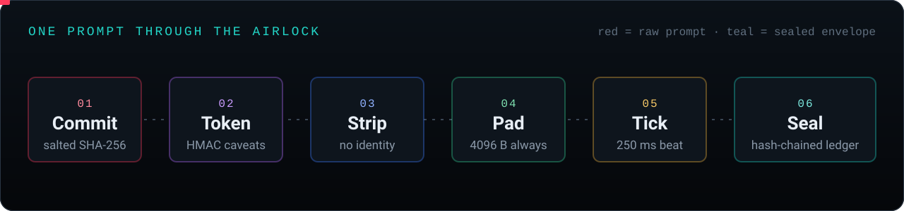
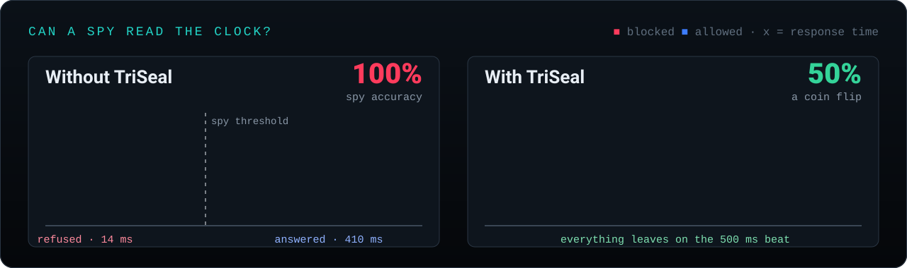
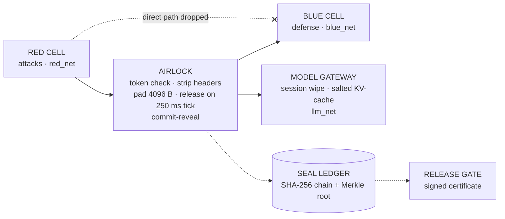

<div align="center">

<a href="https://tri-seal.vercel.app"></a>

<br>

<a href="https://tri-seal.vercel.app"></a>
<a href="https://youtu.be/-StZUSAF26E"></a>


**Red-team your AI model without anyone being able to cheat — and hand out evidence anyone can re-verify.**

[Live demo](https://tri-seal.vercel.app) · [Watch the tour](#-watch-the-90-second-tour) · [Quick start](#-quick-start) · [How it works](#-how-it-works) · [Bring your own data](#-bring-your-own-data)

</div>

---

## ▶ Watch the 90-second tour

<a href="https://youtu.be/-StZUSAF26E" title="Watch TriSeal in 90 seconds on YouTube"></a>

<p align="center"><sub>The preview above plays on its own. <a href="https://youtu.be/-StZUSAF26E"><b>Click it for the full narrated video on YouTube →</b></a></sub></p>

## 🧩 Why TriSeal

When attackers, defenders and a model share one sandbox, red-team scores quietly lie:

| | What goes wrong | How TriSeal closes it |
| :-: | :--- | :--- |
| 👁️ | **Peeking** — Blue can read Red's raw requests, so the defense studies the exam and block rates inflate. | Separate networks · salted **commit-reveal** before the run |
| ⏱️ | **Timing telegraph** — a refusal in 14 ms and an answer in 410 ms tell Red exactly what Blue blocked. | Constant **4096 B envelopes**, released only on a **fixed beat** |
| 🧠 | **Memory weather** — leftover context and shared KV-cache let yesterday's prompts change today's answers. | **Twin-run** KL test against a shuffle noise floor |
| ✍️ | **Unprovable ink** — logs can be edited after the fact; a screenshot is not evidence. | **Hash-chained ledger** + published Merkle root + signed certificate |

## 🔐 How it works



1. **Commit** — Red and Blue publish salted SHA-256 hashes of their attacks and defenses *before* they meet. Changing either afterwards breaks the reveal.
2. **Token** — every request carries an HMAC-signed capability token pinned to `cell=red`, `action=relay` and a short expiry. Edit a caveat and the signature fails.
3. **Strip** — cell IDs, nonces, user agents and hosts are removed. Blue sees content, never identity.
4. **Pad** — every message becomes the same 4096-byte envelope, filled with hash-seeded noise.
5. **Tick** — responses wait for the next edge of a fixed cadence; idle beats send cover traffic.
6. **Seal** — each event is hash-chained to the one before and rolled into a Merkle root you can publish.

## 📉 Side channels, measured — not assumed



**Leak Hunter** puts a spy in the observer's seat: it learns a time threshold on half the trials and guesses *blocked* vs *allowed* on the rest. TriSeal reports the spy's accuracy with a bootstrap 95 % CI and a permutation test, and flags a leak only when the CI's lower bound is above 52 %. Drop in your own latency log to see where your system stands, and how it would look behind the airlock.

## 🧾 Evidence you can re-verify



Every step lands in a hash-chained **Seal Ledger**. The verifier catches a single edited byte, and it also catches the cunning forger who rewrites every hash after it, because the published root no longer matches. The **Release Gate** issues an **ECDSA P-256 signed certificate** only when all six checks pass on *your own* data. Demo and sample runs can only produce a certificate marked *REHEARSAL — NOT VALID FOR RELEASE*.

## 🛠️ The workspace

The landing page explains the system; **Open TriSeal** opens the workspace in a new tab, and each tool opens in its own tab so the live release checklist stays beside you.

| Tool | What it proves | Try it with |
| :--- | :--- | :--- |
| **Overview** | Live release checklist and the three-party sign-off | — |
| **Airlock Relay** | Commit-reveal, HMAC tokens (with a forge test), header stripping, constant envelopes, cadence release — plus a dataset runner that scores a committed defense | `prompts.csv` |
| **Seal Ledger** | Hash chain, Merkle checkpoint and inclusion proofs; catches edits *and* rewrite-every-hash forgeries | `ledger.json`, `ledger-tampered.json` |
| **Conformance** | Your running sandbox vs `isolation-contract.yaml`, invariant by invariant | `observed-config.yaml` |
| **Leak Hunter** | Held-out timing attacker with bootstrap CI and permutation test; twin-run KL vs a shuffle noise floor | `timings-leaky.csv`, `timings-sealed.csv`, `twin-run.csv` |
| **Release Gate** | Reads every check; missing or simulated evidence never passes; issues and verifies signed certificates | the certificates it issues |

> [!NOTE]
> **Measured vs simulated.** Demo buttons, the in-page demo ledger, the reference sandbox and the bundled sample files are **simulated** and never count toward a release, even if a sample is downloaded and re-uploaded. Only your own files, or a real operation such as a relay, count as **measured**. In CI, reject any certificate whose `grade` is not `release`.

Everything runs **in your browser** with Web Crypto. Files you drop in are parsed locally and never uploaded; results live in `localStorage` and are shared between tabs.

## 🚀 Quick start

Requires **Node.js ≥ 20.19**. Python ≥ 3.10 is optional (API and CLI verifier).

```bash
npm run setup     # install site dependencies
npm run dev       # http://localhost:5173
```

Start `npm run api` in a second terminal to run the API alongside the site.

| Command | What it does |
| :--- | :--- |
| `npm run dev` | Vite dev server on port 5173 |
| `npm run build` | Production build into `site/dist` |
| `npm run preview` | Serve the production build locally |
| `npm run api` | FastAPI backend on port 8000 (`pip install -r requirements.txt` first) |
| `npm run verify` | Ledger self-test with the Python CLI — exits 0 |
| `npm run verify:tamper` | Same, with a simulated tamper — exits 1 |

## 📥 Bring your own data

Every tool accepts drag-and-drop, paste, or a sample file from [`site/public/samples/`](site/public/samples).

<details>
<summary><b>Accepted formats and columns</b></summary>

<br>

| Tool | Format | Required columns (aliases accepted) |
| :--- | :--- | :--- |
| Airlock Relay | CSV, TSV, JSON, JSONL, TXT | `prompt` (`text`, `goal`, `input`, …); optional `label` (`attack`/`benign`, `1`/`0`) and `category` |
| Leak Hunter — timing | CSV, TSV, JSON, JSONL | `latency_ms` (`latency`, `ms`, `duration`, …) and `label` (`blocked`/`allowed`, `1`/`0`) |
| Leak Hunter — twin-run | CSV, JSON | `run_a` and `run_b`, or long form `run` + `value` |
| Seal Ledger | JSON, JSONL, CSV | `seq, cell, type, detail, prev, hash` (`event_type`, `prev_hash`, `entry_hash` also work); optional `printed_root` |
| Conformance | YAML, JSON | Same shape as `isolation-contract.yaml`, with or without `invariants:` |

The ledger verifier accepts both this site's format (`|` separator) and the CLI/API format (`||`).

</details>

## ✅ Verify in CLI

```bash
python cli/triseal_verify.py --self-test                    # exit 0 when the chain verifies
python cli/triseal_verify.py --self-test --simulate-tamper  # exit 1 — proves the check bites
```

With the API running, `POST /api/verify` returns `{"valid": false, "failed_at_seq": n}` when the ledger has been altered.

## ☁️ Deploy to Vercel

The repository is ready to import as-is: root directory = repository root, no framework preset, Node.js 20.x or 22.x. `vercel.json` already sets the install and build commands, `site/dist` as output, the Python function in `api/index.py`, security headers (CSP, HSTS, frame denial) and long-lived caching for hashed assets.

```bash
npm i -g vercel
vercel          # preview
vercel --prod   # production
```

## 🏗️ Architecture



<details>
<summary><b>The eight-stage protocol</b></summary>

<br>

| Stage | Step | Mechanism |
| :--- | :--- | :--- |
| 01 | Contract | `isolation-contract.yaml` declares runtime, networks, envelope and cadence |
| 02 | Seal | Each party runs in its own rootless container on its own network (`docker-compose.yml`) |
| 03 | Bind | Red and Blue publish salted SHA-256 commitments |
| 04 | Relay | Capability token, OPA policy (`policy/airlock.rego`), header strip, pad, cadence release |
| 05 | Record | Hash-chained ledger with Merkle checkpoints |
| 06 | Hunt | Timing distinguishability with bootstrap CI |
| 07 | Twin-run | KL divergence between a fresh and a shared run |
| 08 | Certify | Release gate issues a signed certificate over all evidence |

</details>

<details>
<summary><b>Threat model</b></summary>

<br>

| Protects against | Does not protect against |
| :--- | :--- |
| Cross-team visibility via network, filesystem and direct API paths | Hardware micro-architectural side channels on shared CPU cores |
| Cross-session contamination from shared KV-cache or leftover context | A compromised host kernel or container-runtime escape |
| Post-hoc log tampering, cherry-picking or swapping the defense after a run | A malicious operator of the trusted airlock and ledger |
| Timing and size side channels above the measured noise floor | Covert channels below Leak Hunter's statistical resolution |

</details>

<details>
<summary><b>Project layout</b></summary>

<br>

```
site/                    Vite multi-page web app (landing, overview, five tools)
  src/                   engine.js (crypto + stats), shared.js (layout), upload.js (BYOD), one module per page
  public/samples/        Sample datasets for every tool
api/index.py             FastAPI backend (Vercel serverless function)
cli/                     Dependency-free Python verifier
policy/                  OPA policy for the airlock
assets/readme/           Animated SVGs used in this README
isolation-contract.yaml  The published isolation contract
docker-compose.yml       Sealed cells and networks for local runs
```

</details>

## 🗺️ Status & roadmap

Works today in the browser: every tool above, with real SHA-256, HMAC-SHA256 and ECDSA P-256 via Web Crypto.

<details>
<summary><b>Known limitations</b></summary>

<br>

- The API's `/api/leakhunt` and `/api/twinrun` return fixed reference numbers, and `/api/certificate` uses a SHA-256 digest rather than a real signature. Treat the web tools as the source of truth until these are wired up.
- Macaroon root keys and certificate signing keys are generated per page load. For production, pin a server-held signing key and publish its public key.
- The CLI's `--cert` and `--check-contract` flags are reserved; only `--self-test` is implemented.

</details>

**Next:** server-side signing with a pinned key, transparency-log anchoring for Merkle roots, live container conformance via the Docker API, and a CI gate command.

## 👥 Maintainers

| Maintainer | Area |
| :--- | :--- |
| **Jyotasana** | Infrastructure & isolation — compose networks, runtime hardening, conformance, canaries |
| **Arpita Matta** | Core backend — airlock, commit-reveal, model gateway |
| **Anand Minejes** | Evidence & frontend — ledger, verifier, Leak Hunter, twin-run, web app |

<div align="center">

<br>

**Three parties. Three seals. One finding you can prove.**

<sub>MIT licensed · <a href="https://tri-seal.vercel.app">tri-seal.vercel.app</a> · <a href="https://youtu.be/-StZUSAF26E">watch the tour</a></sub>

</div>
