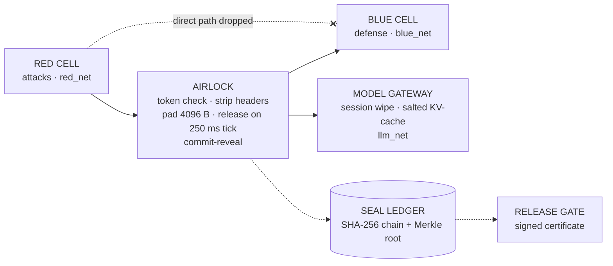

# TriSeal — Sealed red-teaming for AI models

> **Three parties. Three seals. One finding you can prove.**

TriSeal lets a red team, a blue team and the model under test run an AI safety evaluation **without anyone being able to cheat** — and produces evidence a third party can re-verify.

- **Sealed cells.** Red, Blue and the model never share a network; only the airlock touches all three.
- **A size- and timing-blind airlock.** Every message is padded to a constant envelope and released only on a fixed cadence, so neither length nor latency leaks the defense's decision.
- **Commit before you compete.** Red and Blue publish salted hashes of their attacks and defenses before they meet.
- **Evidence in ink.** Every step is hash-chained and Merkle-checkpointed; change one byte and verification fails.
- **A release gate.** Results feed a gate that issues an ECDSA-signed certificate only when every check passes.

Everything in the web app runs **in your browser** with Web Crypto. Files you drop in are parsed locally and never uploaded.

## Watch the tour

<!-- After uploading to YouTube, replace YOUTUBE_VIDEO_ID below (two places) with the ID from the video URL:
     https://www.youtube.com/watch?v=YOUTUBE_VIDEO_ID  -->
[](https://www.youtube.com/watch?v=YOUTUBE_VIDEO_ID)

*TriSeal in 90 seconds — click to watch on YouTube.*

---

## Contents

1. [Why](#why)
2. [Quick start](#quick-start)
3. [Using TriSeal](#using-triseal)
4. [Bring your own data](#bring-your-own-data)
5. [Verify in CI](#verify-in-ci)
6. [Deploy to Vercel](#deploy-to-vercel)
7. [Architecture](#architecture)
8. [Threat model](#threat-model)
9. [Project layout](#project-layout)
10. [Status & roadmap](#status--roadmap)
11. [Maintainers](#maintainers)

## Why

When attackers, defenders and a model share one sandbox, red-team scores quietly lie:

1. **Peeking** — if Blue can read Red's raw requests, the defense studies the exam and block rates inflate.
2. **Timing telegraph** — a refusal in 14 ms and an answer in 410 ms tell Red exactly what Blue blocked.
3. **Memory weather** — leftover context and shared KV-cache let yesterday's prompts change today's answers.
4. **Unprovable ink** — logs can be edited after the fact; a screenshot is not evidence.

TriSeal closes each of these and measures what is left.

## Quick start

Requirements: **Node.js ≥ 20.19**. Python ≥ 3.10 is optional (API and CLI verifier).

```bash
npm run setup     # install site dependencies
npm run dev       # http://localhost:5173
```

Or start the site and the API together:

```bash
./scripts/dev.sh            # macOS / Linux / Git Bash   (--no-api, --build)
```

```powershell
powershell -ExecutionPolicy Bypass -File scripts\dev.ps1   # Windows   (-NoApi, -Build)
```

| Command | What it does |
| :--- | :--- |
| `npm run dev` | Vite dev server for the site on port 5173 |
| `npm run build` | Production build into `site/dist` |
| `npm run preview` | Serve the production build locally |
| `npm run api` | FastAPI backend on port 8000 (`pip install -r requirements.txt` first) |
| `npm run verify` | Ledger self-test with the Python CLI |
| `npm run verify:tamper` | Same, with a simulated tamper — exits 1 |

## Using TriSeal

The landing page (`/`) explains the system; **Open TriSeal** opens the workspace (`/app.html`) in a new tab. Each tool opens in its own tab so the live checklist stays beside you.

| Tool | What it proves | Try it with |
| :--- | :--- | :--- |
| **Overview** | Live release checklist and the three-party sign-off | — |
| **Airlock Relay** | Salted commit-reveal, HMAC capability tokens (with a forge test), header stripping, constant envelopes, cadence release, and a dataset runner that scores a committed defense | `prompts.csv` |
| **Seal Ledger** | Hash chain + Merkle checkpoint + inclusion proofs; detects edits *and* "rewrite every hash downstream" forgeries | `ledger.json`, `ledger-tampered.json` |
| **Conformance** | Diff of your running sandbox against `isolation-contract.yaml`, with critical/warning severity | `observed-config.yaml` |
| **Leak Hunter** | Held-out timing attacker with bootstrap 95% CI and permutation test; twin-run KL against a shuffle noise floor | `timings-leaky.csv`, `timings-sealed.csv`, `twin-run.csv` |
| **Release Gate** | Reads every check; missing or simulated evidence never passes; issues and verifies ECDSA P-256 signed certificates | certificates it issues |

Results are stored in the browser (`localStorage`) and shared between tabs; **Start a fresh evaluation** on the overview clears them.

### Measured vs simulated evidence

Demo buttons, the in-page demo ledger, the reference sandbox and the bundled sample files are great for learning — but they are **simulated** and never count toward a release, even if a sample is downloaded and re-uploaded. Only your own files (or a real operation such as a relay) count as **measured**.

- All six checks pass on measured evidence → **release certificate** (`grade: "release"`).
- Nothing fails, but some checks are simulated → **rehearsal certificate**, signed and marked *REHEARSAL — NOT VALID FOR RELEASE*, listing the simulated checks.

The grade is part of the signed payload, and the verifier checks it against the evidence. In CI, reject any certificate whose `grade` is not `release`.

## Bring your own data

Every tool accepts drag-and-drop, paste, or a sample file. Sample files live in [`site/public/samples/`](site/public/samples).

| Tool | Format | Required columns (aliases accepted) |
| :--- | :--- | :--- |
| Airlock Relay | CSV, TSV, JSON, JSONL, TXT | `prompt` (`text`, `goal`, `input`, …); optional `label` (`attack`/`benign`, `1`/`0`) and `category` |
| Leak Hunter — timing | CSV, TSV, JSON, JSONL | `latency_ms` (`latency`, `ms`, `duration`, …) and `label` (`blocked`/`allowed`, `1`/`0`) |
| Leak Hunter — twin-run | CSV, JSON | `run_a` and `run_b`, or long form `run` + `value` |
| Seal Ledger | JSON, JSONL, CSV | `seq, cell, type, detail, prev, hash` (`event_type`, `prev_hash`, `entry_hash` also work); optional `printed_root` |
| Conformance | YAML, JSON | Same shape as `isolation-contract.yaml`, with or without `invariants:` |

The ledger verifier accepts both this site's format (`|` separator) and the CLI/API format (`||`).

## Verify in CI

```bash
python cli/triseal_verify.py --self-test                    # exit 0 when the chain verifies
python cli/triseal_verify.py --self-test --simulate-tamper  # exit 1 — proves the check bites
```

With the API running, `POST /api/verify` returns `{"valid": false, "failed_at_seq": n}` when the ledger has been altered.

## Deploy to Vercel

The repository is ready to import as-is.

1. Import the repo in Vercel (root directory = repository root; no framework preset).
2. `vercel.json` already sets the install command, the build command, `site/dist` as output, the Python function in `api/index.py`, security headers (CSP, HSTS, frame denial) and long-lived caching for hashed assets.
3. Set the Node.js version in project settings to 20.x or 22.x.

Or from the CLI:

```bash
npm i -g vercel
vercel          # preview
vercel --prod   # production
```

Before shipping, run `npm run build` and `npm run preview` locally and walk through every tool once.

## Architecture



| Stage | Step | Mechanism |
| :--- | :--- | :--- |
| 01 | Contract | `isolation-contract.yaml` declares runtime, networks, envelope and cadence |
| 02 | Seal | Each party runs in its own rootless container on its own network (`docker-compose.yml`) |
| 03 | Bind | Red and Blue publish salted SHA-256 commitments |
| 04 | Relay | Capability token, OPA policy (`policy/airlock.rego`), header strip, pad, cadence release |
| 05 | Record | Hash-chained ledger with Merkle checkpoints |
| 06 | Hunt | Timing distinguishability with bootstrap CI |
| 07 | Twin-run | KL divergence between a fresh and a shared run |
| 08 | Certify | Release gate issues a signed certificate over all evidence |

## Threat model

| Protects against | Does not protect against |
| :--- | :--- |
| Cross-team visibility via network, filesystem and direct API paths | Hardware micro-architectural side channels on shared CPU cores |
| Cross-session contamination from shared KV-cache or leftover context | A compromised host kernel or container-runtime escape |
| Post-hoc log tampering, cherry-picking or swapping the defense after a run | A malicious operator of the trusted airlock and ledger |
| Timing and size side channels above the measured noise floor | Covert channels below Leak Hunter's statistical resolution |

## Project layout

```
site/            Vite multi-page web app (landing, overview, five tools)
  src/           engine.js (crypto + stats), shared.js (layout), upload.js (BYOD), one module per page
  public/samples Sample datasets for every tool
api/index.py     FastAPI backend (Vercel serverless function)
cli/             Dependency-free Python verifier
policy/          OPA policy for the airlock
scripts/         dev.sh / dev.ps1 launchers
isolation-contract.yaml  The published isolation contract
docker-compose.yml       Sealed cells and networks for local runs
```

## Status & roadmap

Works today in the browser: every tool above, with real SHA-256, HMAC-SHA256 and ECDSA P-256 via Web Crypto.

Known limitations:

- The API's `/api/leakhunt` and `/api/twinrun` return fixed reference numbers, and `/api/certificate` uses a SHA-256 digest rather than a real signature. Treat the web tools as the source of truth until these are wired up.
- Macaroon root keys and certificate signing keys are generated per page load. For production, pin a server-held signing key and publish its public key.
- The CLI's `--cert` and `--check-contract` flags are reserved; only `--self-test` is implemented.

Roadmap: server-side signing with a pinned key, transparency-log anchoring for Merkle roots, live container conformance via the Docker API, and a CI gate command.

## Maintainers

| Maintainer | Area |
| :--- | :--- |
| **Jyotasana** | Infrastructure & isolation — compose networks, runtime hardening, conformance, canaries |
| **Arpita Matta** | Core backend — airlock, commit-reveal, model gateway |
| **Anand Minejes** | Evidence & frontend — ledger, verifier, Leak Hunter, twin-run, web app |

Licensed under MIT.
